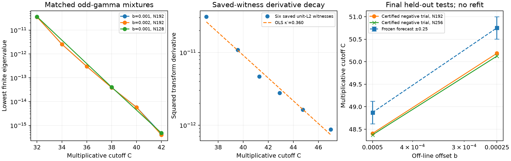

# A final matched-mixture test of the logarithmic calibration

Local follow-up draft, 17 October 2026. Unreviewed and unpublished. Results are finite-family calibration, not a universal detection theorem or an RH proof.

The previous plain-L13 exponent forecast failed its frozen tolerance. That comparison also used an even gamma factor, whereas the collision-path mixtures have an odd gamma factor. The final experiment therefore measures the positive-section decay on the mixture family itself, then tests a fixed balance model against two smaller offsets. No parameter is refitted after those two tests.

The fixed b=0.001 mixture at N=192 and C=32,34,36,38,40,42 gives κ=1.0975310109. The b=0.002 control gives 1.1050317835 on the same grid. N=128 sensitivity fits give 1.1258410405 and 1.1341154150 respectively. These are finite-range slopes of rigorously enclosed positive eigenvalues, not limiting operator exponents. Adjacent slopes vary considerably.

For each of six saved unit-L2 negative witnesses, the squared transform derivative at its own lowest off-line pair height is enclosed independently of the eigenvalue fit. Both the value and derivative are checked against separate formulas. Their fixed six-point regression gives κ′=0.3603024675, with adjacent slopes between 0.281 and 0.490. Since the witnesses vary with both b and C, this is not a controlled measurement varying C alone. The actual finite quartet contribution divided by its leading −4b²|F′|² approximation ranges from 1.000000553 to 1.000645 in these six cases. This good local approximation does not bound the infinite zero tail.

The prescribed balance slope 2/(κ−κ′)=2.7128629487, anchored at the previous N=192 negative cutoff C=6015/128 for b=0.001, forecasts C=48.8726008041 and 50.7530141082 for b=0.0005 and 0.00025. The tolerance is ±0.25 in C. The forecast JSON was written and hash-fixed before either target mixture was selected. The six-point descriptive predictions, also frozen, are 48.8682185999 and 50.8207229876; they cannot substitute for the mechanism forecast after an error.

The fixed forecasts both failed:

| Offset b | Frozen mechanism C | Certified negative C, N=192 | Error in C |
|---|---:|---:|---:|
| 0.0005 | 48.8726008041 | 48.40625 | −0.4663508041 |
| 0.00025 | 50.7530141082 | 50.1875 | −0.5655141082 |

The finite-positive endpoints are 48.375 and 50.15625 respectively. These are local finite-family bisection intervals, not lower bounds on the full minimum negative support. The descriptive predictions also overshoot the certified negative endpoints by more than 0.25; they do not rescue the mechanism. The predeclared stop rule applies: the logarithmic fit remains descriptive only, and no further forecast or post-test fit is made. Larger-degree and fresh-witness details are recorded in the final-round assessment. Both targets have complete H=160 atlases, each accounting for 123 zeros (113 line zeros and five reflected off-line pairs). Each replay checks 5814 contour segments and 118 root gates. The selected pair is the lowest off-line pair, with disks far below its separation. Both negative N=192 trials are freshly reconstructed at 4352 bits. N=256 negative cutoffs are 48.375 and 50.125, confirming that increasing the degree does not rescue either frozen forecast. Finite-positive endpoints do not bound the full minimum support.

In the centered lattice model the unconstrained minimum support can instead be calculated exactly through a two-by-two Gram matrix: as b tends to zero, L_*(b)=π−(32/π)b²+O(b⁴), so C_*(b) tends to exp(2π). This is a written sampling/implicit-function proof, not a Lean theorem or a novelty claim.

A separate mathematical obstruction prevents promoting this evidence to the requested general sine-type theorem. Define

    A_b(z) = ((z²+b²)/(z²−1/4)) cos(πz),
    F(z) = z cos(πz)/(z²−1/4),

with removable values filled in. For every fixed b>0, A_b is a separated sine-type generator. F has fixed Paley–Wiener bandwidth π, vanishes on every real zero of A_b, and has Hermitian pair contribution

    Q_b(F) = −2b² cosh(πb)²/(b²+1/4)² < 0.

Convolution with a fixed even nonnegative smooth bump gives the same sign for a single smooth test with fixed compact support. Hence the infimum support is bounded independently of b in this model. The negative margin shrinks like b², but precision cost and support cost are different. The same note gives a fixed real even smooth witness for an even generator with the positive-height quartet ±1±ib, so the obstruction is not confined to a pair centered at height zero. The detailed [proof and prior-art check](../research/prime_spectral/SINE_TYPE_LOG_COST_OBSTRUCTION_2026_10_17.md) also states the additional positive-frame and derivative assumptions needed for an elementary conditional logarithmic balance lemma. It makes no novelty claim.

The main controls paper remains subject to its human-review release gate. This local follow-up has not been sent to the reviewer or uploaded for publication.
