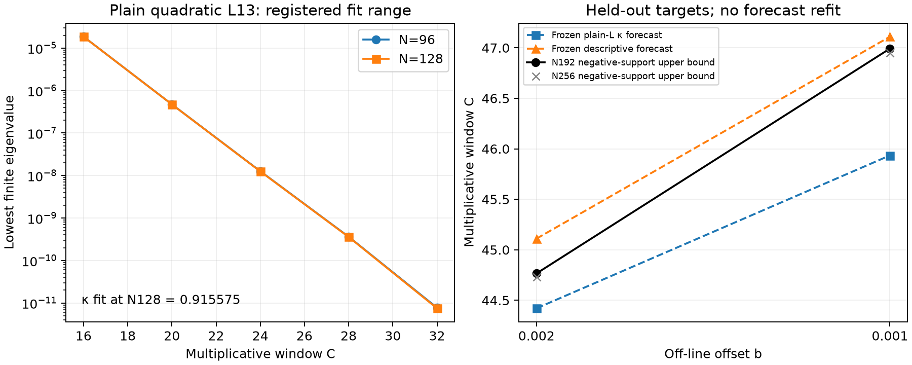

# Testing a plain-L decay forecast against two small-offset controls

Draft research note — 17 October 2026. Unreviewed and unpublished.

Two locally registered forecasts were tested on a conductor-13 Davenport–Heilbronn mixture with its lowest off-line offset reduced to 0.002 and 0.001. Complete interval atlases and exact rational negative trials locate common N192 support upper bounds at C=44.765625 and46.9921875. The earlier descriptive logarithmic fit remains numerically close. A forecast using the independently measured ground-decay rate of a plain conductor-13 L-function misses both registered absolute tolerances. These computations support further logarithmic calibration, but they do not establish the proposed transfer of the plain-L exponent or a universal exchange law.

## Control, units and preregistration

The mixture is the same exact rational family `(1-t)H13,2+t H13,6` as in the [controls paper](dh_controls_paper.pdf). Window size is the multiplicative cutoff `C=exp(2L)`, with additive correlation length `2L=log(C)`.

The plain control is the real primitive quadratic character modulo13, Conrey label12. Its Weil form uses the actual Euler-product coefficients `chi(p^k) log(p)` and the even gamma factor, alpha=1/4. The mixture has the odd gamma factor, alpha=3/4. Conductor-only transfer of a decay constant across these functions is a testable hypothesis. The plain control is also not the collision limit of this mixture family.

At C=16,20,24,28,32, outward finite-matrix eigenvalue enclosures were computed at768bits. The primary N128 ground-eigenvalue log fit gives kappa13=0.9155751479199306; N96 gives0.913981855265866. The adjacent N128 slopes range from0.88864 to0.96658. These are finite-section measurements, not a limiting exponent or a full-operator eigenvalue enclosure. Independent checks validate the prime coefficients against the Dirichlet recurrence and the even-gamma matrix entries against integral formulas.

Platt's [finite-height GRH verification, v1, Theorem7.1](https://arxiv.org/pdf/1305.3087) covers primitive conductor13 L-functions to height10^8/13. No global GRH assertion is used or claimed here.

Before either new mixture parameter, atlas or window was computed, the primary forecast was frozen as

    C_pred(b) = 1373/32 + (2/kappa13) log((1/250)/b),
    2/kappa13 = 2.184419274096445.

Its anchor is the previously certified N192 endpoint at b=0.004. The earlier descriptive model was also retained without refitting:

    C_desc(b) = 37.296088 + 2.885535 log(0.03/b).

The registered absolute-error tolerance is0.25 in C. The forecast record's SHA256 is `bc07008f9b5777ec6c6577f974e649ad00170e4d8956eaf888c22dfd5f70e62a`. This is a local, hash-bound registration, without an independent public timestamp.

## Held-out outcomes

| Offset b | Plain-L mechanism forecast | Descriptive forecast | Certified N192 endpoint | Certified N256 endpoint |
|---|---:|---:|---:|---:|
|0.002|44.420374|45.110262|44.765625|44.730469|
|0.001|45.934498|47.110362|46.992188|46.949219|

The primary mechanism errors, observed minus predicted, are +0.345251 and+1.057689. Both exceed the registered tolerance. The descriptive errors are −0.344637 and−0.118175: one misses the tolerance and one meets it. The tolerance is not widened after seeing these outcomes, and neither model is refitted.

Each complete height160 atlas counts123 zeros:113 critical-line zeros and five off-line pairs. A higher-precision replay checks5814 contour segments and118 root gates. The selected lowest pairs have heights approximately31.4335358285 and31.4335355410, with root-disk radius10^-80, far below their separation. Thus the two new tests use the intended lowest off-line pair.

The N192 negative endpoints are exactly2865/64 and6015/128. Their rational even-sector witnesses, reconstructed at4352bits, give normalized quotients approximately−1.548718e−21 and−2.172323e−22. N256 changes the endpoints by0.03515625 and0.04296875. Positive finite sections encountered during bisection are evidence about those sections, not positive full windows or lower bounds on minimum support. The negative endpoints are certified support upper bounds.

## Interpretation and remaining question

The measured increment between the two new N192 endpoints divided by log2 is3.212251, compared with the frozen plain-L slope2.184419. A post-registration diagnostic extending the plain control to C=40,48,56,64 atN192 gives kappa≈0.948773, hence slope≈2.107987. This diagnostic was explicitly recorded after partial target evidence existed. It does not replace the original forecast, and it does not repair its discrepancy.

The test therefore does not validate a two-term exchange rate with the measured plain-L ground exponent. Possible missing ingredients include gamma parity, which spectral branch is relevant, the different collision-limit function, finite-degree effects and interactions with the other off-line pairs. The computation does not decide which explanation is responsible. No negligible infinite zero-tail bound is supplied, so the selected pair is not asserted to carry the full negative spectral sum by itself.

Six offsets now give a descriptive calibration path, rather than a theorem about b tending to zero. Establishing a universal logarithmic law would require uniform control of the positive contribution, the b-dependent perturbation, the relevant spectral subspace and the infinite tail. Varying height and conductor would also be required to identify a separate height-and-conductor term. Neither these finite certificates nor that proposed asymptotic is an RH proof.
