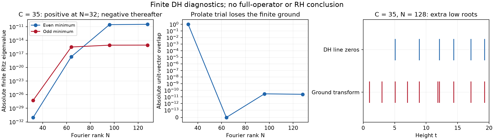

# Finite DH spectral negative control — 24 October 2026

**Outcome:** the missing DH experiment is instantiated. The finite ground
can lose the prolate candidate, and a small residual divided by the ground
gap can coexist with almost zero ground overlap. No arithmetic term or
proved inequality separating zeta from DH has been identified. The spectral
convergence route is consequently classified as **reformulation**.

This is finite numerical evidence plus certified finite spectra. It is not
an RH result, a full-operator counterexample, or a proof of a first failing
window. The existing negative full-form trial remains valid independently.

## Scope and conventions

The [preregistration](DH_SPECTRAL_PREREGISTRATION_2026_10_24.md) preceded the
implementation. The initial grid was `C=10,13,14,20,31,35`, `N=32,64`.
Additional rank-96 tests at `C=13,14,31,35` and rank 128 at `C=35` were
adaptive responses to rank instability, not preregistered predictions.
Rank-64 replays at `C=14,35` increased precision from 512 to 768 bits.

Here `C=lambda^2`, `L=log(C)`, support is `[-L/2,L/2]`, and the cosine/sine
compression has total dimension `2N+1`. The DH matrix uses the existing
conductor-5, odd-gamma, pole-free form and **all** coefficients of `-H'/H`.
It is not a substitution of DH values into zeta's prime-power measure.

The DH candidate is `sqrt(u) sum a_n h_C(nu)`, using the period-5 original
Dirichlet coefficients and the first **odd** prolate mode with parameter
`2 pi C/5`. Its limiting kernel is proportional to `x exp(-pi x^2/5)`.
Its Mellin factor is

`(1/2) (5/pi)^((s+1)/2) Gamma((s+1)/2) H(s)`,

which differs by a constant from the retained completed DH convention.
The odd gamma and conductor normalization pass an independent Gaussian
theta reflection and Mellin-integral test. The finite prolate candidate is
not assumed exactly reflection invariant; its reflection defect is recorded.
Both the candidate and its even projection are numerical, not interval
enclosures of the exact prolate eigenfunction.

The zeta control retains the existing even modes 0/4 zero-integral candidate.
The [CCM paper, section 8](https://arxiv.org/html/2511.22755v1#S8) leaves
both simple-even minimality and candidate comparison open. The
[Connes–van Suijlekom theorem](https://arxiv.org/abs/2511.23257) is conditional
on a simple isolated even minimum; it does not require positivity of the
original form. We do not assert that a lowest even vector is the ground
when an odd vector has lower energy.

## What the experiment found

At `C=35`, the lowest eigenvalues and ground overlap are:

| N | Lowest even | Lowest odd | True finite ground | Trial/ground overlap |
|---:|---:|---:|:---:|---:|
| 32 | `+9.50e-32` | `+5.75e-28` | even | `0.999999759` |
| 64 | `-2.37e-18` | `-3.29e-16` | odd | `0` by parity |
| 96 | `-2.79e-11` | `-8.33e-16` | even | `2.94e-11` |
| 128 | `-3.30e-11` | `-8.59e-16` | even | `2.49e-11` |

Arb integration and FLINT's Rump eigenpair isolation **certify** the signs,
ordering, parity and positive global gaps at ranks 64, 96 and 128. At the
even ranks the boundary value is certified nonzero. At rank 64 the boundary
value of the sine ground is exactly zero, and the required even gate fails.
The overlaps are floating diagnostics for the rounded projected trial.
The sizeable change in eigenvalues between ranks 96 and 128 prevents an
assertion of rank convergence.

For the rounded unit candidate with Rayleigh quotient `mu`, the key numbers
are:

| C, N | `||(A-mu)k||/(lambda_2-lambda_1)` | `lambda_2-mu` | Ground overlap |
|:---|---:|---:|---:|
| 35, 96 | `0.00495` | `-8.33e-16` | `2.94e-11` |
| 35, 128 | `0.00353` | `-8.59e-16` | `2.49e-11` |

Thus **residual/ground-gap alone does not locate the ground state**. The
trial sits above the second eigenvalue. The bound using
`||(A-mu)k||/(lambda_2-mu)` needs positive denominator and cannot be applied
here. This is consistent with the trial following a near-null excited
direction while the negative finite ground has a different profile.

These are residuals of the **finite compressed matrix** on a rounded
double-precision trial. They are not residuals of the full operator or the
exact prolate candidate. Changing prolate/quadrature parameters changes the
tiny residuals: the numerical floor is especially important at large C and
for the much smaller zeta gaps. Do not interpret the displayed residuals as
certified bounds on an exact candidate.



At `C=35,N=128`, the ground transform has numerical roots near
`1.000694`, `3.005160`, and `7.043766`, in addition to roots close to retained
DH line zeros. These are extra low roots relative to the retained atlas.
Their positions move with rank; they have not been interval-certified.
At rank 64 the true ground is odd, so the final diagnostic skips the
even-ground root search rather than substituting the lowest even vector.

The specific predicted transition at `C~85.7/(2 pi)~13.6` is **not
established**. High roots near 85.7 at C=13/14 change substantially with
rank. The heuristic also omitted DH's conductor in its comparison with
prolate resolution. There is no measured first bifurcation or certified
spurious pair at height 85.7. For a finite Fourier section the highest
basis frequency is `2 pi N/log(C)`; roots beyond that range are particularly
unsuitable for inference about the underlying function.

The zeta control at C=10,14,35 and N=32,64 gives numerical absolute offsets
below `2e-29` for its first four zero heights (root bisection itself is
limited to about 30 decimal places). Its trial overlap remains high,
but the double-precision candidate residuals are vastly larger than the
tiny gaps, and its Rayleigh clearance is negative. No exact zeta comparison
bound is obtained either. A successful same-cost floating residual bound
has therefore not been demonstrated on the positive control.

## Reproduction and receipts

Base commit: `a8455dcf978424a7487048f114df3c66552d6f6a`, with the four
pre-existing uncommitted handoff files preserved and extended where relevant.
Runtime: Python 3.12.11, python-flint 0.8.0, mpmath 1.4.1, scipy 1.18.1,
numpy 2.5.4. No Lean source, existing proof manifest, release or CI state
was changed. No new CI proof-chain receipt is claimed.

From the repository root, choose a **new output path**; scripts refuse to
overwrite a receipt:

```sh
uv run --with python-flint==0.8.0 --with scipy==1.18.1 --with mpmath==1.4.1 --python 3.12 python experiments/prime_spectral/dh_ground_state_diagnostic.py --cutoffs 35 --modes 128 --bits 768 --legendre-terms 140 --quadrature-nodes 192 --output /tmp/dh-C35-N128-new.json
uv run --with python-flint==0.8.0 --with mpmath==1.4.1 --python 3.12 python experiments/prime_spectral/dh_spectral_window_certificate.py --cutoff 35 --modes 128 --output /tmp/dh-C35-N128-spectrum-new.json
```

Primary consolidated data and input hashes are in
[summary.json](verification_2026_10_24_dh_spectral/summary.json). The inputs
are `dh_rank32_64_corrected.json`, `dh_rank96_refined.json`,
`dh_precision_replay.json`, and `dh_C35_rank128.json`. The precision replay
supersedes the earlier rank-64 C=14/35 records in the summary. Both smallest
even and odd eigenvalues agree between 512- and 768-bit runs to all 65
printed significant digits at those two configurations; this does not
resolve rank or prolate-projection error.

The independent finite spectral certificates are
`finite_C31_N64_current_certificate.json` and
`finite_C35_N{64,96,128}_parity_certificate.json`. Historical exploratory
receipts are retained. `pilot.json` and `dh_rank32_64.json` precede the
reflection quadrature correction. `sources_v1/` and `sources_v2/` retain
matching earlier source versions. Earlier diagnostic records may label the
lowest **even** transform while their `ground_is_even...` flag is false;
the final diagnostic and consolidated data explicitly handle true parity.
No early record is evidence of an even true ground at C=35,N=64.

Root finding uses real sign changes and bisection. It may miss even
multiplicities and is not a count of all real or complex zeros. Reference
DH zeros come from the retained height-340 atlas, hashed as an input, not a
fresh atlas proof in this round.

## Validation and remaining work

Six new tests check basis-integral Fourier normalization/removable poles,
known transform roots, direct zeta integrals versus the assembly recurrence,
negative eigenvalue ordering, the DH odd/conductor Gaussian convention,
and prolate/quadrature refinement. The eight existing DH research controls
and four existing coefficient controls also pass. The DH register checker
passes with eight routes.

The full historical research-gates replay still fails. Direct canonical-index
replay reaches the unchanged `verify_sector_start.py` assertion
`('Changed parent artifact', '.github/workflows/ci.yml')`. Neither that
verifier nor that workflow has a working-tree diff. This is the pre-existing
historical-manifest failure from the handoff, left unrepaired; no immutable
manifest was refreshed. Full Lean build and external human review were not
run for these numerical additions.

The next mathematical requirement is still a particular arithmetic estimate
which controls the exact zeta candidate's ground projection with the right
spectral clearance and full-operator error. This experiment supplies no
such estimate. The Liu exponent-system route remains uninstantiated, and
finite Carathéodory–Fejér formalization remains a shared prerequisite.
