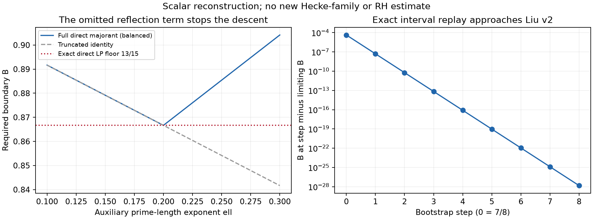

# Liu exponent system: direction 2, 24 October 2026

**Phase 1 outcome:** the exact scalar reconstruction reproduces 7/8, the
fixed-moment algebraic endpoint and Liu v2's
`0.87495701942009894612860385056145298...`. It checks the uniform central
endpoint by polynomial positivity, all 29 listed auxiliary reserves, and
eight interval bootstrap steps without assuming the next step's moment
hypothesis.

**Count improvements alone cannot reach RH while Liu's full direct
majorant is retained:** even deleting every count constraint leaves an
exact direct-side optimum of **13/15**. This is a limitation of the frozen
comparison, not a new arithmetic impossibility theorem. No novelty is
claimed for this floor. The ordinary Guth–Maynard theorem also does not
supply the missing Hecke-family count at the baseline normalization.

No new Hecke estimate, zero-free theorem or Lean replay is claimed. The DH
register was updated before development; the original planning note is
retained in the receipt directory. The parked row-density route stays parked.

## Source and intended checks

Use [Liu v2](https://arxiv.org/html/2610.12234v2), including Parts IV and
section 34, rather than identifying v1's fixed-moment endpoint with v2's
variable-moment fixed point. Source archive downloaded from
`https://arxiv.org/src/2610.12234v2`, SHA-256
`da1db207bb54437245c4fff75f33cfb29088f32f57e6364a6b3b955bc3372204`.
The source is held in temporary storage, not vendored into this repository.

Reconstruct the supplied count by optimizing the separate moment bounds
on the SAME detector class, not by treating their upper exponents as lower
bounds on actual character counts. Reproduce 7/8, the fixed-kappa algebraic
bound, and the variable-moment endpoint. Exact rational/symbolic identities
and real-algebraic root isolation should support the reconstruction;
floating parameter optimization alone is insufficient.

The arithmetic uses ideal norms in Q(sqrt(-3)), an inverse polynomial with
ideal Mobius coefficients and an unweighted polynomial, both twisted by one
common sextic/ray character. Normalized sums of length U^r and U^m have
simultaneous squared large values U^(delta*r) and U^(delta*m).
Selected prime products of total length U^z contribute squared amplitude
U^(2*delta*x*z), where delta=2a-1 and 0<=x<=1/2. Keep conductor, deleted
Euler factors, coefficient and common-character restrictions explicit.

The original inverse moment has constraints r+2z<=1 and 2r+8z<=3;
the unweighted fourth moment has 2m+6*kappa*z<=1. These are closure
inequalities of strict analytic ranges, not permission to apply the
analytic estimates exactly at equality. The amplified long inverse count
has exponent 1-alpha+(alpha-delta)*r, alpha=5/6. Parameter changes are
hypotheses for sensitivity calculations, not newly proved estimates.

Before any conjectural substitution, retain the full direct majorant in
Liu (22.4)-(22.6), not just B=11/12-ell/4. In particular the support
conditions l_x,l_y>ell already exclude the formal ell=5/3 RH substitution.
Check the exact direct-side minimization even after **deleting all
nonprincipal-count inequalities**, a relaxation stronger than improving
those counts by any large-value conjecture. Do not call the relaxed
optimum an achieved conditional zero-free bound.

The candidate inequality for arithmetic development is a genuinely smaller
uniform exponent for the same simultaneous detector/prime-product class,
with the original ideal coefficients, supports, coprimality and height
dependence. The DH global half-plane analogue is false by the retained
classical theorem; b_91-b_7*b_13=-1-kappa_DH^2 refutes the needed reciprocal
multiplicativity transfer. A corresponding new DH moment implementation
is absent, so the route remains uninstantiated as an analytic strategy.

## Large-values transport audit

Use the [published Guth–Maynard theorem](https://annals.math.princeton.edu/2026/203-2/p06)
and [Chen–Gupta–Li v2](https://arxiv.org/html/2507.08296v2) as primary
sources. Their ordinary integer Dirichlet-polynomial/Dirichlet-character
families must not be identified with Liu's varying-conductor ideal sextic
family. A statement about a varying real height is not a count over u.
Record both raw-amplitude normalization and conductor/range compatibility.

A dedicated prior-art search has already located public discussion of the
direct-side 13/15 LP floor. That is a lead against novelty, not a technical
premise. The mathematical ledger will be derived from Liu's primary
equations, and no novelty claim is made for a resulting barrier.

The completed results and remaining gaps follow.

## 1. Exact reconstruction and coverage

Implementation:
`experiments/prime_spectral/liu_exponent_system.py`. Primary receipt:
[scalar_verified.json](verification_2026_10_24_liu_exponents/scalar_verified.json).
Fractions are exact; SymPy performs rational identities and Bernstein
coefficient calculations. Reported decimals are displays of isolated
rational intervals, not inputs to the proofs.

| Component | Primary equations | Local verification |
|---|---|---|
| Full direct majorant, free total length | (22.4)-(22.6) | All max terms retained; exact primal/dual direct LP certificate |
| Nonprincipal contribution | (18.4)-(18.5) | Free-length formula and cancellation of z0 at d=h |
| Moment/detector count | (9.1), (9.3), (28.1), (29.1)-(29.3) | Closed formula checked against an independent exact piecewise-affine minimax |
| Uniform endpoint over delta,x | (31.1)-(31.2) | Eight positive Bernstein bounds and zero discriminant constant |
| Remaining scalar reserves | Lemma 31.2 | All 29 expressions positive on the full rational xi interval; bounds exceed 1/25000 |
| Bootstrap | Sections 30,33 | Eight interval steps, kappa supplied by the preceding bound |
| Fixed-point root | (33.1), (33.4) | Rational root bracket, negative derivative, exact elimination identity |

The analytic moment estimates, theta identities, Euler correction bounds,
contour arguments and continuation criterion are **imported from the
unrefereed source**, not proved by this scalar reconstruction. The external
Lean project was not rebuilt. The replay is therefore not an independent
proof of Liu's zero-free theorem.

For `c=2/(3*kappa)`, `D=3-(1+c)x`, `P=(2-cx)(1-x)` and `alpha=5/6`, the
reconstructed count is

`J=(alpha-delta)D+delta P`,

`t=1+delta P/(2J)`,

`R=1-delta+(alpha-delta)delta P/(2J)`.

The independent optimizer subdivides the detector length interval
`t-1/2<=r<=t`, `m=t-r`, at all active moment-support switches and crossings
of the affine supplied count bounds. It takes the **worst** detector split
and the best available bound on that same class. It does not multiply
counts from different characters or assume independence. Closure lengths
model suppressed strict margins; the analytic estimates are not applied
exactly at those equality boundaries.

The baseline values are:

| Choice | Boundary |
|---|---:|
| Original b=1/8, ell=1/6 | 7/8 = 0.875 |
| Fixed kappa=3/4 | (1507-2 sqrt(921))/1653 = 0.874957069799168740... |
| Variable-moment fixed point | 0.874957019420098946... |

The first three bootstrap outputs are
`0.874957069799168740...`, `0.874957019479158414...`, and
`0.874957019420168181...`. Every step uses
`kappa=2*B_previous-1`; no step assumes its own smaller zero-free bound.
At the limit, the exact elimination polynomial is
`1188 xi^3-2160 xi^2+171 xi+190`, with the isolated root
`xi=0.388583354266034667...`. The positive weights in Liu (34.4) and his
analytic optimality argument remain source inputs; the local reconstruction
checks the endpoint and fixed point, not every alternative contour proof
in section 34.

## 2. A count-independent direct-side obstruction

Let `M=l_x+l_y`, `b=l_y-l_x`. Liu's full direct bound is

`B_low=5/6+l_x/6+G-ell/6+k(M,ell)/2`,

`G=max(0,b/12,b-l_y/2)`,

`k=max(0,(1+3ell-2M)/4,M+ell-1,(3ell-1)/2)`.

Because `G>=b/12`, three necessary lower bounds are

`L0=5/6+M/12-ell/6`,

`A=23/24-M/6+5ell/24`,

`LK=1/3+7M/12+ell/3`.

Their exact convex combination is

`(17/30)L0+(2/5)A+(1/30)LK = 13/15`.

All three weights are positive and sum to one; their M and ell coefficients
cancel. Hence **B_low>=13/15 for every real M,ell** whenever this majorant
is used. There is no numerical parameter scan in this lower-bound proof.
It is sharp for the direct problem: `l_x=7/20`, `l_y=9/20`, `ell=1/5`
give `G=b/12`, `k=0`, and `B_low=13/15`, with `l_x,l_y>ell`.

This also catches a second omission in the simple identity
`B=11/12-ell/4`. On balanced lengths the **full** boundary is

`11/12-ell/4 + max(8b+3ell-3,0)/12 + max(5ell-1,0)/8`.

The last term becomes active at ell=1/5. The formal ell=5/3 RH
substitution violates the length conditions and drops this reflection loss.
Even the weaker support-only inequality `B>=5/6+(M-2ell)/12>5/6`
already excludes that substitution, as recorded in Liu's Lemma 34.3.

Deleting all nonprincipal-count inequalities is more optimistic than
substituting any stronger count into them. Since the direct constraint
survives that deletion, **no improvement confined to those counts reaches
B=1/2 with this direct majorant intact**. This is the requested negative
test for the unchanged architecture. It does not exclude a different
direct estimate, residue extraction or arithmetic architecture.

There is an additional domain restriction in the printed assembly:
the principal Euler domain is stated only for `437/500<=B<=7/8`.
Changing that domain would require separate analysis. The structural
13/15 floor remains even if one grants such a domain extension. Neither
13/15 nor 437/500 is being asserted as an achieved conditional zero-free
bound with conjectural counts.

A prior-art search located [public discussion of this 13/15 floor](https://rstation.ai/r/riemann_hypothesis/posts/15).
That informal discussion is not used as a proof; the certificate above is
derived from Liu's primary equations. This run makes no novelty claim for
the barrier or for parameterizing alpha, which Liu already discusses in
section 34.3.



## 3. What the free-input model measures

`MomentInputs` exposes the amplification exponent, both inverse-moment
prime-length costs and the unweighted moment's length/prime costs.
`nonprincipal(...)` accepts an arbitrary supplied R separately. The model
therefore prices changes without declaring them true arithmetic estimates.
It rejects parameter ranges in which its monotone length-face reduction
would cease to be valid. It does not invent arbitrary higher moments.

At the rational representative
`delta=388583354266/10^12`, `kappa=749914038840/10^12`, `x=1/2`:

| Formal input | Supplied central count exponent R |
|---|---:|
| Published inputs | 0.666666667 |
| alpha reduced from 5/6 to 4/5 | 0.665576431 |
| alpha reduced to 3/4 | 0.663673047 |
| First inverse prime cost reduced from 2 to 3/2 | 0.657003519 |
| Unweighted prime cost reduced from 6 kappa to 5 kappa | 0.666061134 |

These are exact fixed-t minimaxes, choosing the best of 201 rational t
samples and the relevant closed-form candidate times. The sampling is not
a proof of the global t optimum for the altered inputs. They are **not new
values of B**: the critical class and geometry would have to be reoptimized,
all other classes checked, and the proposed moment estimates proved.

## 4. Guth–Maynard and the conjecture are not plug-in family inputs

At Liu's critical class the independently reconstructed values are

`delta=0.388583354266...`, `t=1.124227146786...`,
`r=0.715633619783...`, `m=0.408593527004...`,
`z_M=0.142183190109...`, `z_S=0.040629755884...`.

A normalized polynomial of length `U^r`, times selected primes of length
`U^z`, has raw length exponent `n=r+z` and large-value exponent
`v=r(1+delta)/2+z(1/2+delta*x)`. At `x=1/2`,

`sigma=v/n=(1+delta)/2=0.694291677133...`.

The same identity holds for the squared short polynomial with its prime
product. Integer powers do not change this leading amplitude exponent.
For ordinary integer polynomials, Guth–Maynard Theorem 1.1 improves on the
displayed classical bounds in the interior amplitude range `(0.7,0.8)`;
the present critical normalization lies below it. Their theorem is about
one coefficient sequence sampled at separated real heights, not a sum
over sextic characters indexed by varying ideal conductors.

For illustration **only**, falsely identifying the ordinary height range
with U would turn their three-term theorem into

`max(2n-2v, 18n/5-4v, 1+12n/5-4v)`.

For the critical inverse/prime product or squared-short/prime product this
is about **0.705840229**, which is worse than the supplied **2/3**.
For the unselected long polynomial it is about **0.925051524**.
These numerical comparisons are a normalization audit, not a theorem
transporting any bound to the Hecke family.

[Chen–Gupta–Li v2, Theorem 1.1](https://arxiv.org/html/2507.08296v2)
does count primitive Dirichlet characters, but at a **fixed integer
modulus q**, and requires `N>=(qT)^(2/3)`. Liu's arithmetic uses ideals and
varying inducing conductors, plus common presentations, exclusions and
zero extensions. No reduction preserving those conditions and paying
the conductor/height cost is supplied here. Thus no CGL exponent was
inserted into the exponent system as a proved input.

The precise ordinary conjecture is [Guth–Maynard Conjecture 1.5](https://arxiv.org/html/2405.20552v2):
an ordinary time large-value set has size at most
`T^o(1) N^(2-2sigma)` under its stated hypotheses. We do **not** identify
this with a density hypothesis for Liu's sextic family. For example,
the detector permits a limiting short length `m=0`; a literal
family-wide assertion independent of family multiplicity would try to
bound a large-value set for a constant polynomial by `U^o(1)`, even
though that polynomial carries no character discrimination. An admissible
family conjecture must specify and handle that range, among other issues.

Consequently a numerical “B under the large-values conjecture” is **not
claimed**. Its Hecke-family transport is uninstantiated. The count-free
13/15 certificate already answers the RH-reach question without assuming
such a transport or an unproved equivalence to a density hypothesis.
This rejects the simplest off-the-shelf substitution, not all possible
Guth–Maynard-inspired Hecke estimates.

## 5. Reproduction, validation and next arithmetic target

```sh
uv run --with sympy==1.14.0 --python 3.12 python -m unittest discover -s experiments/prime_spectral -p test_liu_exponent_system.py -v
uv run --with sympy==1.14.0 --python 3.12 python experiments/prime_spectral/liu_exponent_system.py --output /tmp/liu-scalar-new.json
python3 experiments/prime_spectral/check_dh_research_gate.py
```

Use a fresh output path: the generator refuses to overwrite a receipt.
The source version, base commit and input-source archive hash are bound in
the JSON. Earlier receipts and their matching source versions are retained;
the current result is `scalar_verified.json`. No old verification manifest
was rewritten. No commit, new CI proof-chain claim or release is made.
The observed literature-file prefix preceding this round's append is also
retained. Its bytes do not match the older spectral manifest's literature
binding; the cause is unestablished and that immutable manifest was not
altered. This discrepancy is recorded in `prior_snapshot_scope.json`, not
treated as evidence about either mathematical calculation.

Twelve focused tests cover the exact uniform certificates, root isolation,
bootstrap ordering, independent minimax comparison, full direct losses,
normalization, sensitivity monotonicity and invalid substitutions. The DH
gate and the retained exact DH reciprocal/coefficient replay also pass.
The historical Lean/research-round verifier was not rerun for this scalar
addition; its earlier parent-artifact failure is not repaired here.

The natural next **unproved** arithmetic input is a better long inverse
family moment, for the same ideal Mobius coefficients and sextic twists:

`sum_{q_u~U}^{(6)} |M_u(U^r)|^2 << U^(1-alpha_new+alpha_new*r+epsilon) (1+T_1)^A`,

with `alpha_new<5/6` for a relevant range `1<r<=3/2`, retaining the original
smooth u-dependent weights, coprimality and height hypotheses. Alternatively
one needs a valid larger selected-prime range or a joint detector estimate.
The sensitivity numbers merely price these hypotheses; none has been
proved. Any RH endpoint additionally requires changing the direct side.

The DH analogue of that new family estimate has not been constructed.
The retained exact defect `b_91-b_7*b_13=-1-kappa_DH^2` obstructs transferring
the ideal-Mobius Euler-product identities; it is not itself a cancellation
proof. The global DH half-plane analogue is already false by the classical
theorem in the register. The route remains **uninstantiated as a new
analytic strategy**, with the count-only RH endpoint excluded in the
unchanged direct architecture.
