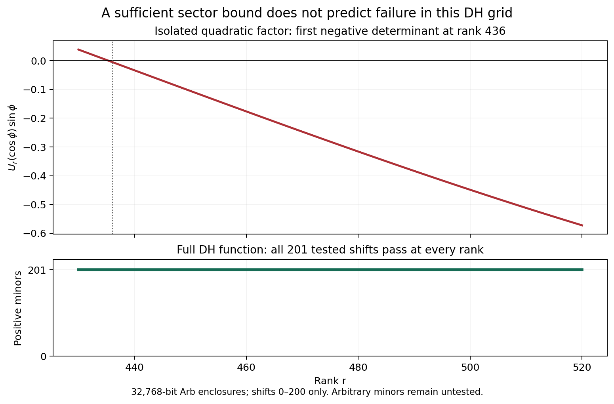

# DH sector rank, localized packets, and the window cost audit

The decisive D4 experiment is completed: the steepest completed DH zero is certified, its sector guarantees PF435, but **all 18,291 requested solid minors through rank 520 are positive**. Thus the isolated quadratic's rank-436 failure does not survive in this tested family of full-function minors. This does not locate the globally first failing minor.

All changes remain in the separate codex/xi-eigenvector-reduction worktree. No commit or merge was made. The [evidence directory](verification_2026_10_12_sector) contains the generators' outputs and replay records.

| Requested direction | Result in this round | Boundary |
|---|---|---|
| D4 steepest zero and PF435 | Complete contour count 249 = 235 line zeros + 14 off-line zeros below height 340; all seven right-hand disks certified; higher zeros excluded from being steepest | Written functional equation, positive theta integral, order/genus argument and Schoenberg sector theorem remain analytic dependencies outside Lean |
| D4 ranks 430–520, shifts 0–200 | All 18,291 strictly positive, none unresolved, at 32,768 bits; full condensation replay and 24 complementary-determinant checks | Finite solid grid only; no global first-failure rank or PF520 assertion |
| D3/D4 negative supports | DH negative at C=30.75390625; conductor-13 analogue at C=33.875; Epstein x²+5y² at C=19.875 | Upper bounds for a negative full support, not minimum supports; positive finite endpoints are evidence only |
| D1 C=6.5, e², 9.5 | Certified finite inertia; full-complement cost pilot exposes large dimensions | No new full-window positivity record at these cutoffs; no independent confirmation of Liu |
| Euler ablations | Both absolute coefficients and prime-power-only coefficients still give certified negative trials at C=31 | Neither isolated property restores positivity in these artificial forms |
| D6 matched effective blocks | Several substantial correction singular values, including intervals with no new active prime power | Numerical finite sections in specified coordinates and shift; the tested low-rank induction ansatz fails, not every conceivable exact identity |
| D2 housekeeping | Slope-two/prolate background explicitly treated as prior art; exact count remains a certificate obligation | No novelty claim for the prolate count |
| D3 theorem | [Modulated local packet and explicit infinite tail](LOCALIZED_TURAN_PACKET_2026_10_12.md); Turán partial-sum hypothesis explicit | Universal ordinate-only Φ remains unproved |
| Finite Lean targets | Schur inertia after completion of the square; actual shift-one Toeplitz determinant equals Chebyshev U and its sine quotient; six-theorem axiom audit clean | Finite algebra only; analytic operator realization and sector theorem remain outside Lean |

## 1. Complete DH zero atlas and the exact index convention

At \(\sigma=3/2\), direct Arb evaluation of the periodic absolute Dirichlet series gives
\[
 \sum_{n\ge2}|a_n|n^{-3/2}<0.737591<1.
\]
Thus \(H(s)\ne0\) for \(\Re s\ge3/2\). The completed functional equation excludes **completed** zeros at \(\Re s\le-1/2\). This is not a claim excluding the trivial zeros of the uncompleted \(H\) farther left. Every completed zero has \(|\Re\rho-1/2|<1\).

The counterclockwise rectangle \([-1/2,3/2]+i[0,340]\) has winding count **249**. The real bottom has argument increment zero by the positive theta integral already proved in the [DH note](DH_FALSIFICATION_2026_10_12.md); \(H(x)>0\) on this interval because its gamma factor is positive. On the other three sides, 5,208 Taylor image rectangles exclude zero and certify the argument increments. There are 235 disjoint certified critical-line sign brackets and seven simple right-hand Rouché disks. Reflection supplies seven disjoint left-hand disks. Their counts sum to the global count, establishing completeness and simplicity throughout the rectangle.

The right-hand zeros have approximate coordinates:

| β | γ |
|---:|---:|
| 0.8085171825 | 85.69934849 |
| 0.6508300806 | 114.1633427 |
| 0.5743560505 | 166.4793059 |
| 0.7242576946 | 176.7024612 |
| 0.8695305796 | 240.4046724 |
| 0.8195495921 | 320.8764897 |
| 0.7682231236 | 331.0502594 |

The exact balls, not the rounded table, determine the comparisons. For a folded zero \(w=(\rho-1/2)^2\), its angular deviation from the negative real axis is
\[
 \phi=2\arctan\frac{|\beta-1/2|}{|\gamma|}.
\]
The 85.6993 zero has \(\phi=0.0071999578790\ldots\), greater than every other enclosed deviation and greater than \(2\arctan(1/340)\). The strip bound therefore controls every higher zero as well. The [atlas](verification_2026_10_12_sector/atlas_H340.json) certifies
\[
 436<\pi/\phi=436.3348656172\ldots<437.
\]

The folded normalized completion has order \(1/2\), hence a genus-zero product with positive constant. Take finite conjugation-invariant product prefixes. Every zero lies in the negative-axis wedge of half-angle less than \(\pi/436\); Schoenberg's sufficient sector theorem gives PF435 for every prefix, and coefficient convergence passes each fixed minor to the entire function. The sufficient theorem does not give an upper bound on the DH PF order. The theorem is reproduced as Theorem B in [Katkova, Multiple positivity and the Riemann zeta-function](https://arxiv.org/pdf/math/0505174). Use its displayed formula, not the inconsistent index in that paper's subsequent numerical example.

For the isolated three-term factor \((1,2\cos\phi,1)\), the shift-one rank-k determinant is
\[
 U_k(\cos\phi)=\frac{\sin((k+1)\phi)}{\sin\phi}.
\]
Ranks through 435 are positive and rank 436 is negative. The approximate angular rank scale is \(\pi\gamma/(2b)\), \(b=|\beta-1/2|\); the shorthand \(\pi\gamma\) presupposes \(b\approx1/2\).

[dh_zero_atlas.py](../../experiments/prime_spectral/dh_zero_atlas.py) generates the count, brackets and disks. [replay_dh_atlas.py](../../experiments/prime_spectral/replay_dh_atlas.py) rechecks every contour piece, bracket and disk at higher precision, allowing additional contour subdivision where the interval algorithm changes its enclosure. The [replay](verification_2026_10_12_sector/atlas_replay.json) closes the same count. This uses the same FLINT backend, not an independent special-function implementation.

## 2. The high-rank full-function minors

[dh_high_rank_scan.py](../../experiments/prime_spectral/dh_high_rank_scan.py) generates 721 ordinary folded coefficients through index 720, sufficient for the requested grid and its condensation dependencies. No factorial weighting is used. The positive scaling \(\mu_n\mapsto100^n\mu_n\) preserves every minor sign.

Desnanot–Jacobi condensation computes
\[
 D_{r,s}=\frac{D_{r-1,s}^2-D_{r-1,s-1}D_{r-1,s+1}}{D_{r-2,s}},
 \quad D_{0,s}=D_{r,0}=1.
\]
Every division requires a certified nonzero divisor; an unresolved value poisons its descendants. A low-rank pilot agrees with direct determinants. At 32,768 bits, every requested cell resolves strictly positive. Generation and scanning took about 1,257 seconds on this machine; this is a measured run, not a complexity theorem.

[replay_dh_high_rank.py](../../experiments/prime_spectral/replay_dh_high_rank.py) reproduces the entire sign digest and checks ranks 430, 435, 436, 437, 480 and 520 at shifts 1, 2, 5 and 20 by a different determinant identity. For \(h_n=[z^n]1/f(-z)\), Jacobi's complementary-minor identity gives
\[
 \det(\mu_{s+i-j})_{i,j<r}=\det(h_{r+i-j})_{i,j<s}.
\]
The 24 complementary determinants are also strictly positive. They share the coefficient input, while bypassing condensation divisions.

**Strategic conclusion:** the sector bound is not sharp for these DH solid minors. It remains invalid to infer that all rank-436 minors pass, or that the first failure must exceed 520, because arbitrary row/column sets and unbounded shifts were not scanned. “Strict ladders are exactly zero verification” is therefore too strong as a conclusion of this experiment. Finite positivity remains a poor discriminator on this tested grid.



The [standalone figure](verification_2026_10_12_sector/dh_sector_grid.pdf) is generated by [plot_dh_sector_control.py](../../experiments/prime_spectral/plot_dh_sector_control.py). The upper curve is the scaled quadratic determinant; the lower panel counts certified positive full-function minors rather than comparing determinant magnitudes.

## 3. Three negative-window data points

All supports use \(S=\log C\). The normalized trigonometric trial degree is 80. Exact rational coefficients from an LDL solve are inserted into the full geometric form and their negative quotient is checked in Arb.

| Control | Enclosed zero, approximately (γ,b) | Positive finite evidence C | Certified negative C |
|---|---:|---:|---:|
| DH, conductor 5 | (85.69934849, 0.3085171825) | 30.736328125 | 30.75390625 |
| Root-number-one odd DH analogue, conductor 13, Conrey label 2 | (31.43420501, 0.0836215560) | 33.75 | 33.875 |
| Epstein x²+5y² | (15.66824953, 0.4329696975) | 19.8125 | 19.875 |

The conductor-13 zero is one certified off-line zero, not a complete or steepest-zero atlas. The conductor-17 exploratory control also has a certified off-line zero near \(0.66330618+105.15528688i\), but its tested degree-80 sections remain positive through C=64; it supplies no negative-support data point here.

The conductor controls use \(H=((1-i\kappa)L_\chi+(1+i\kappa)L_{\bar\chi})/2\), with \(\kappa=\Im\epsilon/(1+\Re\epsilon)\), \(\epsilon=\tau(\chi)/(i\sqrt q)\). Their odd completion has root number +1. The Epstein control independently counts representations and uses
\[
 E(s,x^2+5y^2)/2=
 [\zeta(s)L(s,\chi_{-20})+L(s,\chi_{-4})L(s,\chi_5)]/2.
\]
Its gamma factor is \((\sqrt5/\pi)^s\Gamma(s)\), with poles at 0 and 1. The gamma duplication identity and conductor term are tested separately; the DH no-pole form cannot simply be relabeled. [Bombieri–Ghosh, §§1 and 5](https://www.mathnet.ru/eng/rm9410) supplies the relevant background and the Epstein zero center.

These are upper bounds for a negative full window. The displayed zeros have not been proved to cause the corresponding negative witnesses; other zeros can contribute. Finite sections under dilation are not nested across C, and positivity of a finite section is not positivity of the full form. Consequently the displayed “bisection” is a finite-family search with a certified negative endpoint, not a rigorous bracket for the minimum full negative support. Conductors and gamma degrees also differ, so neither proposed asymptotic law is established or refuted by fitting these three rows.

## 4. Arithmetic ablations at C=31

[dh_window_experiments.py](../../experiments/prime_spectral/dh_window_experiments.py) keeps the DH archimedean and conductor terms and changes only the specified log-derivative coefficients.

| Modification | Negative trial outcome |
|---|---|
| Original cₙ | Even quotient approximately −1.531×10⁻³¹ |
| Replace cₙ by \(|c_n|\) | Even negative trial, quotient approximately −4.854 |
| Keep signed prime-power coefficients and delete all others | Even quotient approximately −0.29585; odd quotient approximately −0.52973 |

The exact quotient intervals and rational witnesses are saved and replayed. These artificial forms are not asserted to be explicit formulas of new L-functions. Entrywise positivity or a positivity-preserving semigroup does not imply that a self-adjoint operator is positive semidefinite; the proposed inference would require a separate quadratic-form argument. These tests do not establish that the joint Euler-product structure is insufficient; they rule out either isolated ablation as a positivity restoration mechanism here.

## 5. D1 cost and the D6 matched-coordinate test

At degree 64 and 768 bits, interval inertia certifies the **finite** counts below 0.3:

| C | Count | Approximate top of cluster | Approximate next value | Existing comparison frequency cutoff | Polynomial dimension for coupling+tail <10⁻¹⁰ |
|---|---:|---:|---:|---:|---:|
| 6.5 | 11 | 0.07937 | 0.59004 | 1024 | 2638 |
| 7 | 12 | 0.10497 | 0.52851 | 1024 | 2740 |
| e² | 13 | 0.16115 | 0.56069 | 4096 | 11168 |
| 9.5 | 17 | 0.09942 | 0.53164 | 16384 | Not closed at 16382 |
| 10 | 18 | 0.11741 | 0.50250 | 16384 | Not closed at 16382 |

The tabulated eigenvalues are midpoint diagnostics; inertia is the certified statement. Direct adaptive integration checks selected closed-form entries independently. The finite sections are positive, but no full outer gap, exact full spectral projector, or full compressed positivity is thereby certified.

The current lower comparison requires
\(\beta=\log(T/(2\pi))-1/T-\sum_{p^k<C}2\log p/\sqrt{p^k}>0\).
Its loss of the oscillatory prime structure drives the large T and dimension. The cost cannot be inferred from internal precision alone. These numbers show that this particular comparison needs replacement before a practical independent test of Liu at e² or 9.5. An outer gap plus projector distance is also insufficient for positivity of a tiny block unless the signed complementary Schur correction is controlled at the relevant small scale.

For D6, dilate all Fourier bases to the same unit interval, use the complete eigenbasis of the left finite section for **both** operators, retain its cluster coordinates, and compare finite Schur blocks at t=−1. At 6.5→7 the largest correction singular values are approximately (0.391,0.0569,0.0314) even and (0.312,0.0534,0.00458) odd. At 9.5→10 they begin (0.498,0.189,0.105) even and (0.390,0.109,0.101) odd. No new prime power is active in either open interval; at C=7 the endpoint correlation is exactly zero.

Thus neither correction is numerically rank one or rank equal to the number of new active prime powers in these coordinates. The Frobenius corrections are about 14–18% of the left shifted blocks. Drop this matched-coordinate low-rank ansatz. This is not a proof that no special arithmetic basis or different shift can yield an identity.

## 6. Prior art, verification, and open obligations

[Connes–Consani, Spectral triples and zeta-cycles, §3](https://ems.press/content/serial-article-files/44477) already explains the prolate origin and approximate number of very small Weil eigenvalues; its parameter \(\lambda^2\) is this repository's C. The slope-two phenomenon is background, while certifying a specified threshold count for D1 remains work. [Bombieri 2000](https://www.bdim.eu/item?id=RLIN_2000_9_11_3_183_0) is direct prior art for finite negative indices, vanishing negative eigenvalues and limiting eigenvector dependencies. See the [localized theorem note](LOCALIZED_TURAN_PACKET_2026_10_12.md) for the exact remaining D3 filter problem.

A targeted search on 12 October combined Davenport–Heilbronn with Toeplitz, Pólya frequency, total positivity, Schoenberg and PF435. It did not identify a directly matching published high-rank grid experiment. This limited search does not establish novelty. The existing [zeta-lab DH control](https://github.com/teal-sea/zeta-lab/issues/57) is prior numerical work for the C=31 negative window, not a new result of this round. The proposed note should present the atlas and specified grid as reproducible evidence and retain the arbitrary-minor caveat.

All 26 selected tests passed: five sector/condensation tests, six additional arithmetic, gamma, tail and witness tests, and fifteen existing control, refinement and packet tests. The atlas and full high-rank sign stream were replayed. The revised reduction PDF was rebuilt and its added pages visually inspected.

The two requested finite Lean targets are now checked in [WeilSchurInertia.lean](../../Reinmann/WeilSchurInertia.lean) and [ToeplitzQuadraticChebyshev.lean](../../Reinmann/ToeplitzQuadraticChebyshev.lean). The first proves the negative-index identity from an explicit completion of the square with a nonnegative complement; the second identifies the actual tridiagonal Toeplitz determinant, rather than merely defining a matching recurrence. The [combined audit](verification_2026_10_12_sector/FiniteTargetsAudit.lean) contains exactly the canonical proof bodies and prints six axiom dependencies, all limited to `propext`, `Classical.choice`, and `Quot.sound`. Standalone checks also completed; a missing real-number import in the Schur file was corrected and rechecked. Linter warnings remain in the Chebyshev file. The 2,013-job Mathlib dependency build succeeded; the full repository root build was not rerun. Final formal verification finished on 13 October after substantial import-loading delays under swap pressure. The [validation record](verification_2026_10_12_sector/lean_validation.json) and manifest bind the checked sources and logs by hash.

Still open: the globally first negative DH Toeplitz minor; the minimum negative full support for each control; universal ordinate-only Φ; full positivity/projector/complement certificates at 6.5, e² and 9.5; and an exact arithmetic induction. No RH proof or new window record is claimed.

## Replay commands

Run from this worktree's root. The first command checks declared hashes; the two replay commands recompute the corresponding certificates using the saved inputs.

```sh
python3 experiments/prime_spectral/verify_research_round.py
uv run --with python-flint==0.8.0 --with mpmath --with numpy --python 3.12 python experiments/prime_spectral/replay_dh_atlas.py
uv run --with python-flint==0.8.0 --with mpmath --with numpy --python 3.12 python experiments/prime_spectral/replay_dh_high_rank.py
PYTHONPATH=experiments/prime_spectral uv run --with python-flint==0.8.0 --with mpmath --with numpy --python 3.12 python -m unittest -v test_dh_research_controls test_refine_cluster test_window_packet_bound test_dh_sector_program test_research_round_controls
```

The full coefficient generation and grid scan can be repeated with `dh_high_rank_scan.py --min-rank 430 --max-rank 520 --max-shift 200 --bits 32768` under the same `uv run` environment. This overwrites that generator's saved outputs and takes substantially longer than the replay. `dh_zero_atlas.py` exposes `discover`, `line`, `winding` and `assemble` as separate actions, all with `--height 340`.
